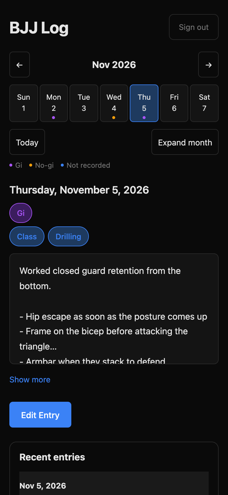

# BJJ Log

A phone-first training journal for Brazilian jiu-jitsu. Pick a day on the calendar, tag the session, and write down what you learned.

Built with Next.js, React, TypeScript, and Postgres, and deployed on Vercel. I use it for my own training, so it is a single-user app with no public demo. This repository holds the source only; no journal data is included.

<p align="center">
  
</p>

## Features

- Week-view calendar that expands to a full month, with entry dots tinted by gi or no-gi
- Notes for each training day, with multi-select session types such as class, drilling, and open mat
- Long entries that collapse behind a "Show more" toggle
- Technique tags: up to five per note, added by hand, from one-tap suggestions, or by optional AI tagging. Each tag sits in a broad bucket such as guard or passing
- A Tags screen that lists every tag with its note count and the last time you trained it, opens every note for a tag, searches note text, and works through untagged old notes
- A note cleaner that suggests spelling fixes for technique names, such as "de la hiva" to "de la riva", with no AI call, plus a grammar check on request. Nothing changes until you accept it
- Password-protected access with signed, expiring sessions
- Safe, repeatable import of notes from the app's earlier browser-only version

## Engineering highlights

- **Authorization in every route.** Each data endpoint checks the session itself, and each write also verifies that the request is same-origin.
- **Signed sessions.** Cookies are HMAC-signed, HttpOnly, and SameSite=Strict. The signature includes a password fingerprint, so changing either credential ends every session.
- **Runtime validation.** TypeScript types don't exist at runtime, so all HTTP and browser-storage input passes through [`lib/entries.ts`](lib/entries.ts).
- **Careful migrations.** [`scripts/migrate.mjs`](scripts/migrate.mjs) runs in one transaction under an advisory lock and rejects any applied migration whose checksum has changed. Builds never apply migrations.
- **Non-destructive import.** One atomic SQL statement adds only dates that are missing, so a retry is safe and existing entries are never overwritten.
- **Deliberate releases.** Only the `prod` branch can deploy, enforced by both [`vercel.json`](vercel.json) and a build-time check.
- **No lost drafts.** A failed save keeps the editor open with your text intact.
- **Frugal AI.** Every model call goes through one layer with a hard output cap per job. Outputs are saved with a hash of their input, so unchanged input costs nothing, and a text match against existing tags is tried before any call. Token counts are recorded per job.

The [architecture guide](ARCHITECTURE.md) covers the data flow, module boundaries, and the reason behind each invariant.

## Tech stack

| Area | Choice |
| --- | --- |
| Framework | Next.js 15 (App Router), React 19 |
| Language | TypeScript in strict mode |
| Database | Postgres on Neon, using `pg` and plain SQL migrations |
| Styling | CSS Modules, with no UI library |
| Testing | Playwright |
| Hosting | Vercel |

## Getting started

You need Node.js 22 and a Postgres database. The [setup guide](CONTRIBUTING.md#setup) has the details.

```bash
npm ci
cp .env.example .env.local   # then fill in your own values
npm run db:migrate
npm run dev
```

Open http://localhost:3000 and sign in with the password you set.

## Checks

```bash
npm run typecheck
npm run lint
npm run build
```

Browser tests use Playwright, and one of them writes to the database, so read the [testing guide](docs/TESTING.md) first.

## Project layout

| Path | Contents |
| --- | --- |
| `app/components/` | Journal, calendar, entry editor, and Tags screen UI |
| `app/api/` | HTTP routes for entries, import, login, logout, and the AI features under `app/api/ai/` |
| `lib/` | Entry validation, authentication, and the database pool |
| `lib/ai/` | The AI layer: job runner, job definitions, context builder, provider, and store |
| `lib/glossary.ts` | Technique-name spelling suggestions, with no AI call |
| `db/migrations/` | Ordered SQL migrations |
| `scripts/` | Migration and deployment tools |
| `tests/` | Playwright browser tests |
| `dev/` | Development-only previews at `/dev` and `/dev/tags`: the real UI with made-up data |
| `docs/` | [Documentation index](docs/README.md) |

## Credits

Built by Alex Sigua, with help from AI coding agents. [`AGENTS.md`](AGENTS.md) is the guide they follow.

## License

[MIT](LICENSE)
